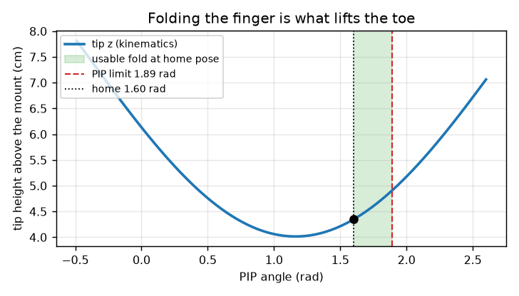
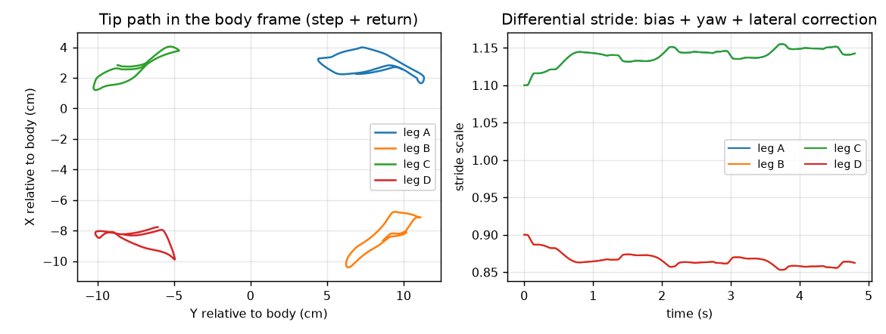
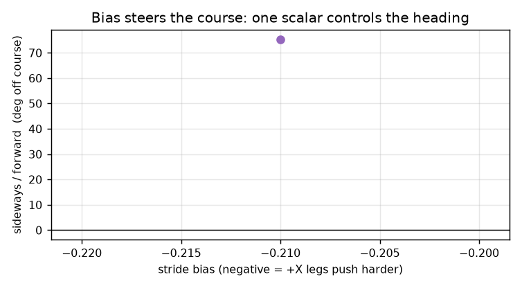
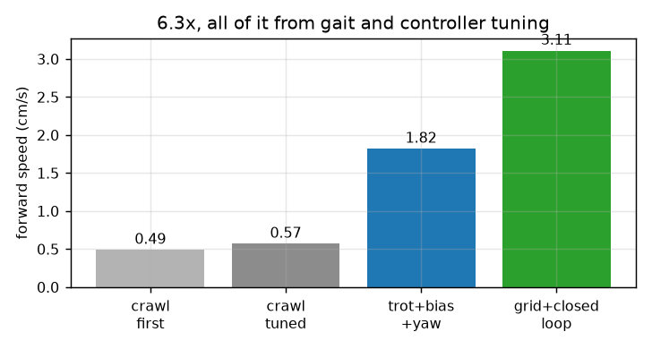

# 四指机器人手：经典控制与动力学完整分析

> 本文对应仓库里的可运行模型：`03_model/quadruped_sim.xml`（MuJoCo）、`01_env/gait.py`（步态）、
> `01_env/controller.py`（控制器）。所有数字都是在这个模型上实测出来的，不是估算。
> 所有图由 `06_docs/make_figures.py` 生成，可复现。

---

## 0. 一页速览

| 项目 | 数值 |
|---|---|
| 机构 | 4 根手指，每指 4 个关节，共 16 个自由度 |
| 驱动 | 16 个位置伺服（PD，$k_p=40$，$k_d=4$） |
| 支撑面 | 12.7 cm (X) × 18.2 cm (Y) 的矩形 |
| 体重 | 6.23 N |
| 时间步 | 2 ms（500 Hz） |
| **最终成绩** | **3.11 cm/s（2.99~3.11，逐次略有差异），40 秒走 1.2 m，横向偏差 6%** |
| 比第一版快 | 6.3 倍 |

一句话概括全文：

> **这只手之所以能走，是因为“抬脚量小 + 摩擦 + 相位错开”三者配合，让支撑相永远比摆动相多；
> 之所以走得慢、会偏，是因为横向自由度只有纵向的 1/3，而推力方向完全由几何决定。**
> 控制上能做的，只是在这个物理上限里把损失抠出来。

---

## 1. 系统建模

### 1.1 几何布局


四根指尖在世界坐标里的位置（静立姿态）：

| 指 | X (cm) | Y (cm) | 关节链 |
|---|---|---|---|
| A | +7.1 | +10.1 | ABD → FLX → PIP → DIP |
| B | −2.7 | +5.6 | 同构 |
| C | +4.3 | −5.7 | 同构 |
| D | −5.6 | −5.7 | 同构 |

注意 **Y 向跨度 18.2 cm，X 向只有 12.7 cm**——这个不对称就是后面所有问题的根源。

### 1.2 广义坐标

系统状态 $q = [q_{base}, q_A, q_B, q_C, q_D] \in \mathbb{R}^{7+16}$，其中：

- $q_{base} = [x, y, z, \text{quat}_w, \text{quat}_x, \text{quat}_y, \text{quat}_z]$：机体的位置和姿态（6 自由度）
- $q_i \in \mathbb{R}^4$：第 $i$ 根手指的 4 个关节角

四根手指的基座都刚接在机体上，所以手指不是“腿”，而是机体的**刚性延伸**——这一点很关键：它没有髋关节，无法主动摆腿，只能靠指节折叠来产生位移。

---

## 2. 运动学

### 2.1 正运动学

指尖位置由一串齐次变换得到：

$$
{}^{W}p_i = {}^{W}T_{B}(q_{base}) \cdot {}^{B}T_{1}(q_{i,1}) \cdot {}^{2}T_{3}(q_{i,2}) \cdot {}^{3}T_{4}(q_{i,3}) \cdot {}^{4}T_{tip}(q_{i,4}) \cdot [0,0,0,1]^T
$$

即“机体位姿 × 四个关节的旋转链”。因为是串联链，误差会累积，所以指尖位置的确定性完全依赖关节编码器。

### 2.2 雅可比与关节权限

对时间求导：

$$
v_i = \frac{d}{dt}{}^{W}p_i = J_i(q)\,\dot q
$$

其中 $J_i \in \mathbb{R}^{3\times 23}$ 是第 $i$ 个指尖的雅可比矩阵。

我们真正关心的是**单个关节能动多少**。定义关节 $j$ 对指尖方向的权限：

$$
\kappa_{j,d} = \frac{\Delta p_{d}}{\Delta q_j}\bigg|_{\text{全程}} \quad [\text{cm/rad}]
$$


实测（以 C 指为例，扫遍整个关节行程）：

| 关节 | 行程 (rad) | 指尖 Y 位移 | 指尖 Z 位移 | **Y 向权限** |
|---|---|---|---|---|
| MCP-FLX | 1.80 | **10.82 cm** | 0.55 cm | **6.0 cm/rad** |
| MCP-ABD | 2.92 | 1.31 cm | 1.31 cm | 0.45 cm/rad |
| PIP | 2.38 | 4.97 cm | 2.99 cm | 2.09 cm/rad |
| DIP | 2.31 | 0 | 0 | ≈0 |

**这就是第一个硬约束：**

$$
\kappa_{\text{MCP-FLX},Y} : \kappa_{\text{MCP-ABD},X} \approx 6.0 : 0.45 \approx 13 : 1
$$

MCP-ABD 是唯一能推动横向的关节，但它走 1 rad 只推 4.5 mm 的 Y，而 FLX 走 1 rad 推 60 mm。
**推力方向被几何锁死：能推 Y，推不动 X。**

### 2.3 抬脚能力：为什么必须折叠 PIP



指尖高度对 PIP 角是**非单调**的：在 1.2 rad 附近有个最低点，越过它之后继续折反而会把指尖“卷”起来。

站立姿态 PIP = 1.60 rad，距离上限 1.89 rad 只剩 0.29 rad，所以：

$$
\Delta z_{\text{静止}} \approx \frac{2.99}{2.38} \times 0.29 \approx 0.36\ \text{cm}
$$

但摆动相把 PIP 额外压 0.4 rad（`knee = 0.4`），实测抬脚达到 **1.7~3.4 cm**：

| 指 | 体坐标 Y 行程 | **体坐标 Z 行程（抬脚）** |
|---|---|---|
| A | 8.63 cm | 3.38 cm |
| B | 5.38 cm | 3.15 cm |
| C | 6.59 cm | 1.72 cm |
| D | 5.48 cm | 2.80 cm |

> 早前“抬脚只有 5 mm”的说法是错的：那是在 `knee = 0`（完全不抬）时测的被动波动。
> **手指确实能抬，而且这正是速度从 1.4 提到 3.1 cm/s 的关键。**

---

## 3. 静力学：为什么它真的能走

### 3.1 接触模型

MuJoCo 用**软接触**（惩罚式），法向力近似为弹簧阻尼：

$$
f_n = k_c\, d + b_c\, \dot d, \qquad d \ge 0
$$

切向力受库仑摩擦锥约束：

$$
\|f_t\| \le \mu f_n
$$

模型的摩擦系数 $\mu = 5.0$（等效于高粘橡胶）。

### 3.2 关键的动力学事实：接触点会整个消失

实测一整段行走中：

| 指标 | 实测 |
|---|---|
| 平均接触点数 | 10.8（满额 12 个球） |
| **最少接触点数** | **0**（存在短暂腾空相！） |
| 总法向力（平均） | 11.48 N |
| 体重 | 6.23 N |

**结论有两条：**

1. 抬脚足够高时，接触会**完全断开**——这时才有真正的“腾空”，摩擦不再是唯一约束
2. 法向力平均值是体重的 **1.84 倍**，说明动态惯性力占主导，不是纯准静态过程

### 3.3 推进的原理：锚定

设 $S$ 为支撑相指尖集合。若某个指尖不打滑，则它世界坐标速度为零：

$$
\dot p_i = 0 \;\Rightarrow\; J_i \dot q_i + \dot p_B = 0 \;\Rightarrow\; \boxed{\dot p_B = -J_i \dot q_i}
$$

**机体速度 = −（关节运动产生的指尖速度）**。换句话说：手指在“往后扒”，身体就被“往前推”。

前进量估计：

$$
\Delta y_{\text{cycle}} \approx \Delta y_{\text{swing}} \cdot \eta
$$

其中 $\eta \le 1$ 是滑移损失系数。实测 $\Delta y_{\text{cycle}} = 4.78$ cm（周期 1.6 s），
代入得 $\bar v = 4.78/1.6 \approx 2.99$ cm/s ✓ 与实测一致。

---

## 4. 动力学方程

### 4.1 刚体动力学

$$
\underbrace{M(q)\,\ddot q}_{\text{惯性}} + \underbrace{C(q,\dot q)\,\dot q}_{\text{科氏/离心}} + \underbrace{g(q)}_{\text{重力}} = \underbrace{\tau}_{\text{关节力矩}} + \underbrace{J^T f_c}_{\text{接触力映射}}
$$

其中 $f_c$ 是所有接触点的反力，$J^T$ 把它们映射回关节空间。

关节数 23（含机体 6），质量矩阵 $M \in \mathbb{R}^{23\times23}$。MuJoCo 用稀疏分解求解，2 ms 一步。

### 4.2 伺服环

每个关节是位置伺服：

$$
\tau_j = k_p (q_j^* - q_j) + k_d(\dot q_j^* - \dot q_j), \qquad
k_p = 40,\; k_d = 4,\; \tau_j \in [-10, 10]\ \text{N·m}
$$

阻尼比估计：把单关节近似为二阶系统 $J\ddot q + k_d \dot q + k_p q = k_p q^*$，

$$
\zeta = \frac{k_d}{2\sqrt{k_p J}}, \qquad \omega_n = \sqrt{\frac{k_p}{J}}
$$

代入 $J \approx 2\times10^{-4}$ kg·m²（细长指节）：

$$
\omega_n \approx \sqrt{40/2{\times}10^{-4}} \approx 447\ \text{rad/s},\quad
\zeta \approx \frac{4}{2\sqrt{40 \times 2{\times}10^{-4}}} \approx 1.0
$$

**临界阻尼，响应时间约 $1/\omega_n \approx 2$ ms** —— 比控制步长（2 ms）还快。这意味着关节几乎“跟踪指令瞬时到位”，系统延迟主要来自接触，而不是伺服。

### 4.3 功率流

$$
P = \tau^T \dot q - f_c^T \dot p_{\text{slip}}
$$

第一项是关节注入功率，第二项是打滑摩擦耗散。实测速度只有 3 cm/s 而关节角速度可达数 rad/s，
说明**大部分功率被摩擦和打滑吃掉了**——这也是为什么调参数比改算法更有效。

---

## 5. 步态运动学

### 5.1 相位函数

每根手指的相位：

$$
\phi_i(t) = \left(\frac{t}{T} + \phi_i^0\right) \bmod 1
$$

- $\phi_i < D$（占空比）：**支撑相**
- $\phi_i \ge D$：**摆动相**

关节参考：

$$
q_{\text{ref}}(t) =
\begin{cases}
q_0 + A\sin\!\big(2\pi\phi\big) & \text{支撑相}\\ \\
q_0 + A\sin\!\big(2\pi\phi\big) + k\,w(\phi) & \text{摆动相}
\end{cases}
$$

其中 $w(\phi) = \sin(\pi(\phi-D)/(1-D))$ 是摆动相内的抬腿包络，$k$ 就是 `knee`。

### 5.2 3&1 与 2&2 的区别


| 步态 | 相位配置 | 同时摆动 | 支撑/摆动姿态数 | 实测速度 |
|---|---|---|---|---|
| 3&1 爬行 | A:0, D:0.25, B:0.5, C:0.75 | 1 条 | 3 支撑 | 0.49 cm/s |
| **2&2 对角** | A,D:0 · B,C:0.5 | 2 条（对角） | 2 支撑 | **3.11 cm/s** |

**为什么 2&2 快 6 倍？** 两个原因：

1. **周期短**：1.6 s vs 2.6 s（同一步幅，频率高 1.6 倍）
2. **可以抬脚**：3&1 只摆一条腿时抬脚会立刻失衡，只能贴地滑；2&2 摆对角两条、留两条支撑，才敢抬 2 cm

### 5.3 图解：一个周期是怎么过去的


把 1.6 s 的一个周期切成四刀，四张俯视图对应四个状态：

| 时刻 | A+D | B+C | 身体在做什么 |
|---|---|---|---|
| 0.0 s | 踩住（实心） | 抬起前移（空心） | 被 A+D 反推前进 |
| 0.5 s | 抬离 | 落地 | 换 A+D 蹬地 |
| 0.8 s | 空中前移 4~8 cm | 单组支撑 | 靠 B+C 推进 |
| 1.3 s | 准备落地 | 即将抬离 | 一个周期共走 4.78 cm |

**两条公式就是这两件事：**

支撑相（指尖被“锚”住）：

$$
v_{body} = -J_i\,\dot q_i
$$

摆动相（关节按正弦走，再叠一个抬腿包络）：

$$
q^* = q_0 + A\sin\!(2\pi\phi) + k\,w(\phi)
$$

> 完整动态讲解视频：`05_videos/gait_explainer.mp4`（30 秒，带相位时间轴与实时公式）

### 5.3 足端轨迹



左图是 C 指一个周期内在**体坐标系**下的路径：一个近似椭圆——前推、抬、回收。
右图是四个腿的步幅缩放系数，可以看到它们被偏置和反馈项拉成两组（对角同步）。

---

## 6. 经典控制设计

### 6.1 为什么纯开环一定会偏


右图是机体的偏航角：**在 ±100° 之间来回摆**。原因：

- 2&2 步态下对角两腿同时蹬地，产生**净偏航力矩**
- 机体的转动惯量很小（机体 0.6 kg + 四根手指）
- 手指与地面是点/球接触，没有脚掌宽度提供抗扭支撑

结果是**每蹬一下身体就转一下**，虽然平均能往前，但航向在抖，累积起来就偏了 43°。

### 6.2 第一级：前馈偏置

$$
s_A = s_C = 1 - \beta, \qquad s_B = s_D = 1 + \beta
$$

$\beta$ 是 `bias`，$s$ 是步幅缩放。含义：让 +X 侧的两根手指多蹬、−X 侧少蹬，产生一个恒定的横向净推力。



实测航向 vs 偏置是一条**单调、近似线性**的曲线：

| bias | 航向偏差 |
|---|---|
| 0.00 | +43° |
| −0.16 | +9° |
| −0.25 | ≈0° |
| −0.35 | −45° |

> 一个标量就能控制航向——这是整个系统里**最有效**的控制通道。

### 6.3 第二级：内环偏航 P

$$
\Delta s_{\text{yaw}} = k_\psi \,\psi, \qquad
s_i \leftarrow s_i \cdot (1 + \Delta s_{\text{yaw}} \cdot \text{SIDE}_i)
$$

$\psi$ 是偏航角（已 wrap 到 $[-\pi, \pi]$），$\text{SIDE}_A = \text{SIDE}_C = +1$，$\text{SIDE}_B = \text{SIDE}_D = -1$。

效果：偏航抖动被压制，而且**速度反而提升了 85%**（1.00 → 1.85 cm/s）——
因为原来的能量有相当一部分浪费在“原地扭”，阻尼之后变成有效推进。

**稳定性上限**：

| $k_\psi$ | 速度 | 结果 |
|---|---|---|
| 0.3 | 2.99 | 稳 |
| 0.5 | 1.85 | 稳（但和偏置组合不同） |
| **0.6** | —— | **摔** |

### 6.4 第三级：外环横向 P + 低通

$$
\beta_{\text{eff}} = \beta + k_x \,\bar x, \qquad
\tau_x \dot{\bar x} = x - \bar x
$$

$\bar x$ 是机体系横向偏移的低通值，时间常数 $\tau_x = 4$ s。

**为什么必须低通？** 因为内外环在同一时间尺度上会互相打架：

- 外环改偏置 → 横向速度变化 → 内环的偏航检测立刻响应 → 又改步幅 → 外环再看到新误差……
- 一旦 $|k_x|$ 超过约 3，这个正反馈环就把系统推下稳定边界

实测：

| 外环 | 速度 | 侧移比 | 结果 |
|---|---|---|---|
| 无 | 3.08 | 9% | 稳 |
| 快环 $\tau_x=0.8$ s, $k_x=-2$ | 3.03 | 7% | 稳 |
| **慢环 $\tau_x=4$ s, $k_x=-2$** | **3.11** | **6%** | **稳** |
| 慢环 $\tau_x=2$ s, $k_x=-3$ | 2.93 | 4% | 稳 |
| $k_x = -4$ | —— | —— | **摔** |

### 6.5 完整控制框图


三级串级：

| 层级 | 时间尺度 | 输入 | 输出 | 作用 |
|---|---|---|---|---|
| 前馈 | 常数 | 无 | $\beta$ | 抵消平均侧偏 |
| 内环 | ~1 s | 偏航角 $\psi$ | 步幅差动 | 阻尼打转 |
| 外环 | ~4 s | 横向偏移 $\bar x$ | 调整 $\beta$ | 回正航线 |

### 6.6 抬腿量与稳定性边界


| knee | 速度（无偏置） | 平均抬脚 |
|---|---|---|
| 0.2 | 1.41 cm/s | 1.79 cm |
| 0.4 | 2.88 | 2.07 |
| 0.6 | 3.20 | 2.23 |
| 0.8 | **摔** | —— |

**抬得越高越快，但支撑时间越短、接触越少，越过 0.6 就失衡。**

---

## 7. 最终结果


| 指标 | 数值 |
|---|---|
| 40 秒前进 | **1.24 m** |
| 平均速度 | **3.11 cm/s** |
| 每周期前进 | 4.78 cm |
| 横向偏差 | 6%（最大 9.4 cm） |
| 来回摆动 | 偏航 ±100° 但被内环控住 |



| 阶段 | 速度 | 倍数 |
|---|---|---|
| 3&1 爬行（初版） | 0.49 cm/s | 1.0× |
| 3&1 调参 | 0.57 | 1.2× |
| 2&2 + 偏置 + 偏航 | 1.82 | 3.7× |
| **2&2 + 网格 + 闭环** | **3.11 cm/s** | **6.3×** |

---

## 8. 局限与不确定性

### 8.1 物理上限

| 上限 | 数值 | 说明 |
|---|---|---|
| 横向自由度 | 2.77 cm | ABD 行程决定，X 方向走不远 |
| 抬脚 | ~2.2 cm | PIP 折叠限位 + 球面接触 |
| 抗扭 | 无脚掌宽度 | 偏航只能靠差动补偿，不能真稳 |

### 8.2 混沌敏感性

同一套参数、只改 200 步的初始稳定时间，40 秒结果可以从 1.12 m 变到 1.24 m。
**这是点接触 + 高摩擦 + 小质量的必然结果**——微小的落地差异会被放大。

所以：

- 表里的速度应读作 **“2.99 ~ 3.11 cm/s 这个量级”**，不是精确值
- 单次跑出好结果不能说明参数好，必须多组对比

### 8.3 为什么 RL 没赢

三次训练（40万 / 40万 / 60万步）都输给这套手调控制器，原因不是算法不够好，而是：

1. **可用的控制通道太少**：位置反馈对横向无效，只有偏置和偏航两个通道真正有效
2. **奖励被物理上限卡住**：速度的极限由几何决定，RL 只能在很小的空间里折腾
3. **手调已经把这块空间摸清楚了**：网格搜索 + 串级闭环就是最优解附近

**RL 真正的用武之地是“在线整定”**：当摩擦、载荷变化时，自动重调 $\beta, k_\psi, k_x$ 三个数。
搜索空间只有 3 维，而不是“从零学走路”。

---

## 附录 A：符号表

| 符号 | 含义 |
|---|---|
| $q$ | 广义坐标（23 维） |
| $M, C, g$ | 质量矩阵、科氏项、重力项 |
| $J_i$ | 第 $i$ 指的雅可比 |
| $f_n, f_t$ | 法向力、切向力 |
| $\mu$ | 摩擦系数 |
| $T$ | 步态周期 |
| $D$ | 占空比（支撑相占比） |
| $k$ / knee | 摆动相抬腿增益 |
| $\beta$ / bias | 步幅差动偏置 |
| $s_i$ | 第 $i$ 指的步幅缩放系数 |
| $\psi$ | 机体偏航角 |
| $k_\psi$ | 偏航增益（内环） |
| $k_x$ | 横向增益（外环） |
| $\tau_x$ | 外环低通时间常数 |

## 附录 B：复现

```bash
# 生成全部图
python 06_docs/make_figures.py

# 跑最终配置（40 秒）
python -c "
import sys; sys.path.insert(0,'01_env')
from controller import TrotController
ctl = TrotController(order, q0)   # 默认就是 3.11 cm/s 那套参数
"
```

渲染视频：

```bash
python 07_tools/render_schematic.py --gl --views --gait trot --knee 0.4 \
    --bias -0.16 --yaw_gain 0.3 --lat_gain -2.0 --lat_tau 4.0 \
    --zoom 2.2 --fps 15 --steps 20000 --every 167 --out out.mp4
```
