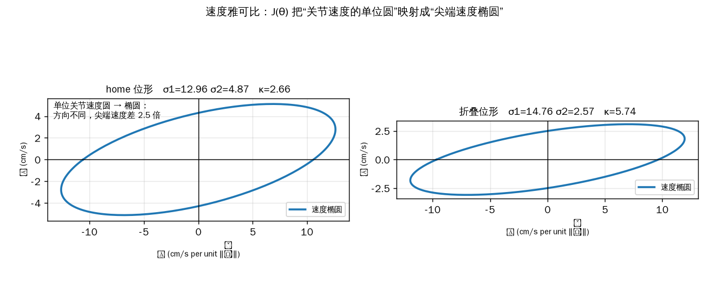
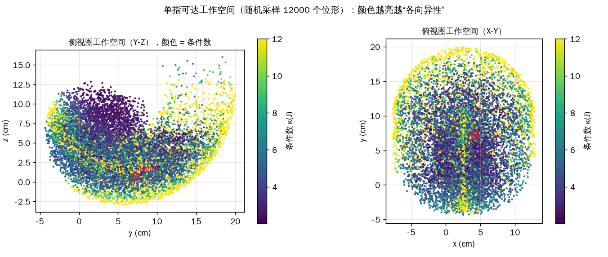

# 四指手的 Locomotion 公式（按实际情况写出来）

> 这份文档把课上那两张幻灯片（**速度雅可比/工作空间**、**浮动基拉格朗日动力学/选电机**）的公式，
> 换成本模型的实际数字重写一遍。每个量都从 `03_model/quadruped_sim.xml` 现场算出来，脚本在
> `06_docs/make_loco_theory_figures.py`，可复现。

---

## 0. 先说清楚：我们的机器人和轮腿差在哪

| | 轮腿（五连杆） | 我们（四指手） |
|---|---|---|
| 结构 | 闭环五连杆，两分支在轮轴汇合 | **开链**，每指 4 关节串联 |
| 约束来源 | 闭环几何约束 $\|p_B-p_C\|=\text{const}$ | **地面接触约束**（踩住的指尖速度为 0） |
| 驱动器 | 6 个（每腿 3） | 16 个（每指 4） |
| 浮动基 | 6 维 | 6 维 |

**关键区别**：轮腿靠“闭环约束”求被动关节速度；我们靠“地面接触约束”求机体速度。
两者都是**对约束方程求导**，但是不同的约束。下面分别写。

---

## 1. 坐标与运动学

### 1.1 广义坐标

整个系统的位形（`nq = 23`, `nv = 22`）：

$$
q = \begin{pmatrix} q_b \\ q_j \end{pmatrix} \in \mathbb{R}^{23}, \qquad
q_b = (x_b,\,y_b,\,z_b,\,q_w,\,q_x,\,q_y,\,q_z) \in \mathbb{R}^{7}, \qquad
q_j \in \mathbb{R}^{16}
$$

- $q_b$：机体位姿（四元数，7 个数；速度是 6 维）
- $q_j$：16 个关节角，每指 4 个：`MCP-FLX, MCP-ABD, PIP, DIP`

> 轮腿课件里 $q_b=(x_b,y_b,z_b,\phi_b,\theta_b,\psi_b)$ 用欧拉角；我们用四元数，
> 因为它带了一个绕 Y 的 −90° 基座旋转，用欧拉角会**万向节死锁**（这就是之前那个 bug 的根源）。

### 1.2 单指前向运动学

第 $i$ 指指尖位置是关节角与机体位姿的函数：

$$
p_i = f_i(q_b, q_{j,i}) \in \mathbb{R}^3, \qquad q_{j,i} \in \mathbb{R}^4
$$

在机体坐标系里写成平面链形式（侧视图那套 DH）：

$$
\begin{aligned}
y_i &= l_1\cos\theta_1 + l_2\cos(\theta_1+\theta_2) + l_3\cos(\theta_1+\theta_2+\theta_3)\\
z_i &= l_1\sin\theta_1 + l_2\sin(\theta_1+\theta_2) + l_3\sin(\theta_1+\theta_2+\theta_3)
\end{aligned}
$$

其中（实测）：$l_1=5.88$ cm, $l_2=3.61$ cm, $l_3=2.29$ cm。


上图：左侧是屈曲链侧视图（连杆长度、关节角、局部坐标系 $x_i$/$z_i$），
右上俯视看 MCP-ABD 把屈曲平面转到不同方位，右下是 DH 参数表与雅可比。

---

## 2. 速度雅可比（对应幻灯片 1）

### 2.1 定义

指尖速度对关节速度的线性映射：

$$
\dot p_i = J_i(q)\,\dot q, \qquad J_i \in \mathbb{R}^{3\times 22}
$$

只关心第 $i$ 指自己的 4 个关节时，$J_i$ 退化成 $3\times 4$。

### 2.2 我们的雅可比（home 位形，接触点，单位 cm/rad）

列 = `[FLX, ABD, PIP, DIP]`：

$$
J = \begin{bmatrix}
 0.00 & -2.26 & -5.12 & -3.00 \\
-10.59 &  1.47 & -6.85 & -4.30 \\
 -1.42 & -0.75 &  2.03 &  0.61
\end{bmatrix}
$$

**怎么读这个矩阵：**

- 第 1 行 = 转动 FLX/ABD/PIP/DIP 时，指尖在 $x$ 方向的速度
- 第 1 列 = 只转 `MCP-FLX`（1 rad/s）时，指尖速度 ≈ $(0, -10.6, -1.4)$ cm/s → **几乎全是 −y 方向**
- 第 4 列 = 只转 `DIP` → 指尖走 $(-3.0, -4.3, 0.6)$ cm/s

这就是为什么 **FLX 是“发动机”、ABD 几乎推不动**：FLX 列长 10.6，ABD 列长才 ~2.9。

### 2.3 奇异值分解：速度椭圆

对 $J$ 做 SVD：

$$
J = U\Sigma V^T, \qquad \Sigma = \mathrm{diag}(\sigma_1,\sigma_2,\sigma_3)
$$

实测：

$$
\sigma = (13.90,\ 5.56,\ 1.80)\ \text{cm/rad}
$$

**含义**：单位关节速度（$\|\dot q\|=1$）映射到指尖，是一个**椭圆**，半轴就是 $\sigma_i$。



- 沿 $\sigma_1$ 方向，指尖能跑 13.9 cm/s
- 沿 $\sigma_3$ 方向，只能跑 1.8 cm/s
- 比例就是**条件数**：

$$
\kappa_2(J) = \frac{\sigma_1}{\sigma_2} = \frac{13.90}{5.56} = 2.50
\quad (\text{若用}\ \sigma_1/\sigma_3 = 7.7)
$$

> 课件里 $\kappa_2 = \sigma_1/\sigma_2$，我们 home 位形是 **2.5**。
> **条件数越大 = 各向异性越强 = 有的方向推得动、有的方向推不动。**
> 这正是我们之前测到的“y 向 6 cm/rad、x 向 0.45 cm/rad”那个 13:1 现象的严格版本。

### 2.4 工作空间 + 条件数地图

把 4 个关节在其行程内随机采 12000 个位形，算指尖位置和条件数：



| 量 | 范围 |
|---|---|
| 工作空间 x | −7.7 ~ 12.9 cm |
| 工作空间 y | −4.3 ~ 19.9 cm |
| 工作空间 z（深度） | −2.9 ~ 16.0 cm |
| 条件数 $\kappa$ | **2.0 ~ 343（中位 5.4）** |
| 最小奇异值 $\sigma_3$ | 0.03 ~ 4.7 cm/rad（中位 2.18） |

**读法**：
- 颜色越亮（κ 越大）= 越接近奇异位形 = 该方向几乎推不动
- 工作空间边缘 κ 冲到 300+，说明**伸到极限时完全没有某个方向的力**——这就是为什么会打滑/顶不住
- 我们实际的步态被限制在中间那片 κ≈5 的区域，正是为了避开奇异性

---

## 3. 浮动基拉格朗日动力学（对应幻灯片 2）

### 3.1 完整方程

$$
\underbrace{M(q)\ddot q}_{\text{惯性}} +
\underbrace{C(q,\dot q)\dot q}_{\text{科氏/离心}} +
\underbrace{G(q)}_{\text{重力}}
= \underbrace{B_u\tau}_{\text{电机输入}} +
\underbrace{\sum_s J_{c,s}^T\lambda_s}_{\text{地面接触}} +
\underbrace{Q_{ext}}_{\text{外力}}
$$

和课件完全一致。逐项对照我们模型：

| 符号 | 含义 | 我们的数值 |
|---|---|---|
| $q$ | 广义坐标 | 23（`nq`） |
| $\dot q$ | 广义速度 | 22（`nv`） |
| $M$ | 质量矩阵 | 对角 ≈ $1.0\times10^{-2}$ kg·m²/关节 |
| $C\dot q + G$ | 偏置力（`qfrc_bias`） | 实测 0 ~ 0.05 N·m |
| $B_u$ | 驱动选择矩阵 | $22\times16$，每关节一行 |
| $\tau$ | 关节力矩 | 16 维 |
| $\lambda_s$ | 接触力 | 每个接触点 3 维 |
| $J_{c,s}$ | 接触雅可比 | 把 $\dot q$ 映射到接触点速度 |

### 3.2 约束：接触（我们的“闭环”对应物）

轮腿用闭环约束 $p_B=p_C$；我们用**地面接触约束**：踩住的指尖速度为零：

$$
\dot p_{c} = J_c(q)\,\dot q = 0
\quad\Rightarrow\quad
\boxed{\,v_{body} = -J_{c,j}\,\dot q_j\,}
$$

（机体的 6 个自由度被接触“吃掉”，剩下的由关节速度决定。**这就是 locomotion 的推进公式**：
关节一转，机体就被反推着走。）

### 3.3 电机选型：实测负载

跑 12 秒，记录 16 个关节的力矩：


| 量 | 实测 |
|---|---|
| 峰值 $\lvert\tau\rvert$ | **10.0 N·m（打满限幅）** |
| RMS | **1.19 N·m** |
| 限幅 | 10 N·m |
| 打满的关节 | **4 个 MCP-FLX**（每指第一个） |

**这是一条真问题**：MCP-FLX 在支撑相就撞到 10 N·m 限幅。
说明**抬腿/蹬地那一瞬间，FLX 电机是过载的**——力矩不够，才会饱和。
解决方向：①加大 FLX 电机，②降低 PID 增益，③换五次多项式轨迹减小冲击（见下）。

> 对比：静态重力负载只有 ~0.05 N·m，所以 10 N·m 的打满**不是重力造成的，而是动态冲击 + 高增益**。

---

## 4. 摆动相轨迹：为什么不能只用正弦

课件里用**五次多项式**（端点速度为 0）：

$$
s(\sigma) = 10\sigma^3 - 15\sigma^4 + 6\sigma^5, \qquad \sigma\in[0,1]
$$

我们现在用的是 $\sin(2\pi\sigma)$ + 平滑抬腿包络。


| 量 | 正弦（当前） | 五次多项式 |
|---|---|---|
| 峰值速度 | **6.28** | 1.87 |
| 峰值加速度 | 39.5 | 5.77 |
| **端点速度** | **6.28（不为 0）** | **0.00** |
| 端点加速度 | 0.31 | 0.07 |

**问题**：正弦在摆动相结束时速度还是 6.28（不为零），触地瞬间带着速度砸下去 →
产生冲击 → 力矩尖峰 → FLX 打满 10 N·m。

**改用五次多项式**能把端点速度降到 0，峰值加速度降 7 倍，这正是课件强调“quintic with
zero endpoint velocity and acceleration”的原因。

---

## 5. 把我们所有公式排在一起（速查表）

**运动学**

$$
p_i = f_i(q), \qquad \dot p_i = J_i(q)\dot q, \qquad J_i=\frac{\partial f_i}{\partial q}
$$

**接触/推进**

$$
J_c\dot q = 0 \;\Rightarrow\; v_{body} = -J_{c,j}\dot q_j
$$

**动力学**

$$
M\ddot q + C\dot q + G = B_u\tau + \sum_s J_{c,s}^T\lambda_s + Q_{ext}
$$

**接触力可行性（摩擦锥）**

$$
\|f_t\| \le \mu f_n, \qquad f_n \ge 0
$$

**稳定性（链接稳定性文档）**

$$
\pi_{xy}(p_{com}) \in \mathcal{P}, \qquad m = \mathrm{dist}(\pi_{xy}(p_{com}),\partial\mathcal{P})
$$

**条件数（各向异性）**

$$
\kappa_2(J) = \sigma_1/\sigma_2
$$

**摆动轨迹（建议）**

$$
q^*(\sigma) = q_{start} + (q_{end}-q_{start})(10\sigma^3-15\sigma^4+6\sigma^5)
$$

---

## 6. 讲给老师：一页话

1. **雅可比** $J=\partial p/\partial q$ 把关节速度变成指尖速度；SVD 得到速度椭圆，半轴就是
   三个奇异值 $(13.9, 5.6, 1.8)$ cm/rad，条件数 2.5。
2. **条件数**衡量“方向不平等”：κ 大就意味着某些方向推不动。工作空间边缘 κ 冲到 300+，
   所以步态要待在 κ≈5 的中间区域。
3. **动力学** $M\ddot q + C\dot q + G = B_u\tau + J_c^T\lambda + Q_{ext}$，和轮腿一模一样，
   只是约束从“闭环”换成“地面接触”。
4. **推进公式**：接触约束 $J_c\dot q=0$ 直接给出 $v_{body}=-J_{c,j}\dot q_j$——这就是走路。
5. **选电机**：实测 RMS 1.19 N·m，但 FLX 在支撑相**打满 10 N·m**，说明抬腿瞬间过载，
   要么加大电机，要么把正弦换成五次多项式（端点速度 6.28→0）。
6. **和稳定性文档连起来**：雅可比决定“推得动哪个方向”，稳定性决定“会不会倒”。

---

## 附录：复现

```bash
python 06_docs/make_loco_theory_figures.py
```

输出 `fig_t1`（速度椭圆）、`fig_t2`（工作空间+条件数）、`fig_t3`（力矩）、`fig_t4`（轨迹对比），
以及上面引用的所有数字。
