# Enabling Locomotion for Dexterous Robotic Hands
## 让灵巧手“走”起来 — 四页结构与讲稿

> 这份文档就是你的 PPT 施工图。每一页给出：**一句话结论 → 要放的图 → 正文文案（中英对照）→ 口语讲稿 → 评审可能问什么、怎么答**。
> 所有数字都来自本仓库实测，不是估计值。

---

## 全篇逻辑（先把这条记住）

整份报告只讲一个因果链，四页依次是它的四环：

$$
\text{这台手很难站稳（5.29 cm 余量）}
\;\Rightarrow\;
\text{所以只能靠接触约束推进}
\;\Rightarrow\;
\text{所以纯学习/纯开环都失败}
\;\Rightarrow\;
\text{所以确定性步态 + 两个标量反馈才成了}
$$

**一句话**：不是我们的算法不够聪明，而是**这台手的物理余量太小**，把可行解的空间压得很窄。

<!--slide-->

## Slide 1 — 平台与问题定义 / Platform & Problem Definition

**这一页要干的事**：不只是“展示我们搭了环境”，而是**把“难”这件事量化立住**。
如果这一页讲完，听众心里没有“5.29 cm / 25.3°”这两个数，后面三页都会显得平淡。

### 1.1 仿真环境 / Simulation Environment

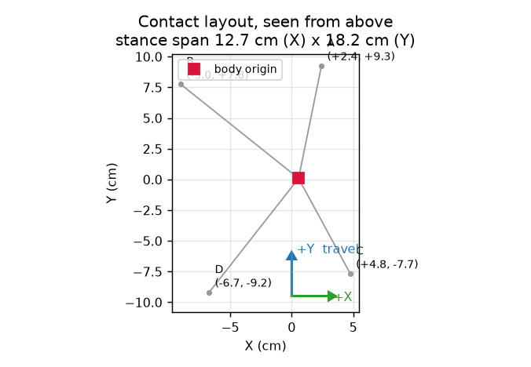

**EN**
- URDF imported into **MuJoCo 3.15**; the hand is 4 fingers × 4 joints = **16 driven DoF** on a **6-DoF floating base** (`nq = 23`, `nv = 22`).
- Each fingertip is a **5-sphere contact pad (1.6 cm wide)** — contact is a small patch, not a point, so it can roll and tilt.
- Base is rotated −90°; Euler angles would gimbal-lock, so the base pose is a **quaternion**.

**中文**
- URDF 导入 **MuJoCo 3.15**；4 指 × 4 关节 = **16 个驱动自由度**，装在 **6 自由度浮动基座**上（`nq = 23`, `nv = 22`）。
- 每个指尖是一块 **5 球接触垫（宽 1.6 cm）**——接触是**小面**不是点，所以会滚、会翘。
- 基座旋转 −90°，欧拉角会万向节死锁，因此基座位姿用**四元数**。

> 图注：`fig1_layout.png` 是**默认（未外展）位姿**下俯视的四个着地点，跨度 **X 12.7 cm × Y 18.2 cm**。
> 张开外展（low stance）后，指尖向内收，跨度变成 **X 13.6 cm × Y 15.6 cm**——**X 变宽、Y 变短**，这是 1.5 节稳定性的来源。两个数不矛盾，是**不同位姿**下的支撑域。

---

### 1.2 关节与连杆 / Joints & Links

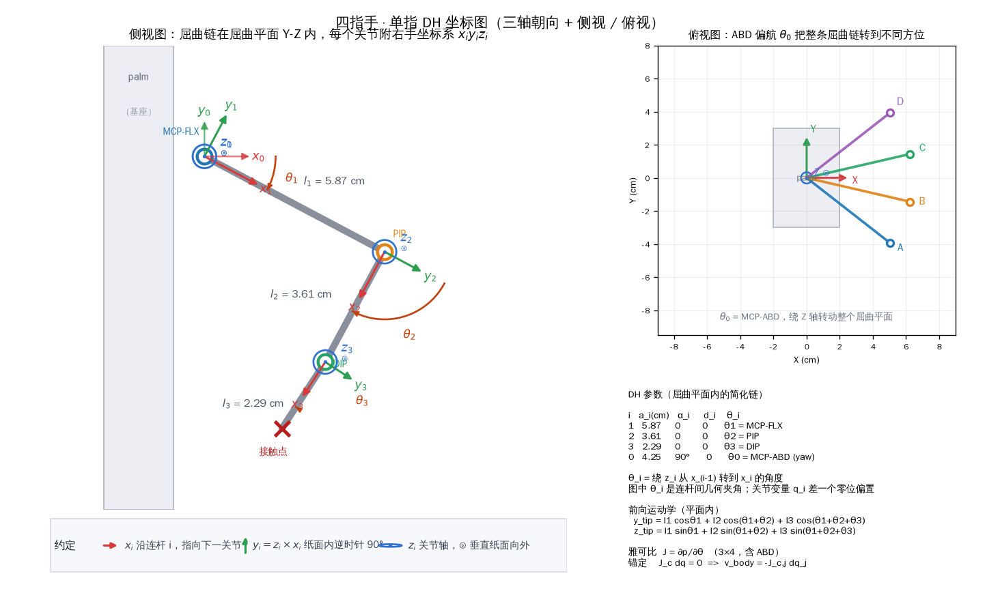

**EN**
- Naming follows human anatomy: `MCP-FLX` (flexion), `MCP-ABD` (abduction), `PIP`, `DIP`.
- Chain: `palm → FLX → ABD → PIP → DIP → tip`. The first three axes are **mutually orthogonal** (a spherical wrist) but **do not intersect** (offsets 3.8 cm and 1.5 cm).
- Measured link lengths between joint axes: `FLX→PIP 59.9 mm`, `PIP→DIP 36.1 mm`, `DIP→tip 22.9 mm`.

**中文**
- 命名取自人体解剖：`MCP-FLX`（屈曲）、`MCP-ABD`（外展）、`PIP`、`DIP`。
- 链条：`掌心 → FLX → ABD → PIP → DIP → 指尖`。前三个轴**两两正交**（近似球铰），但**三轴不交于一点**（偏置 3.8 / 1.5 cm）。
- 关节轴之间的实测连杆：`FLX→PIP 59.9 mm`、`PIP→DIP 36.1 mm`、`DIP→指尖 22.9 mm`。

> ⚠️ 自检：如果 PPT 上标的是 53.1 / 49 mm，那个量的是**到连杆体原点**，不是到下一个关节轴。二者都对，但**必须能说清量的是哪两个点**。建议统一写成 “measured between joint axes”，用 59.9 / 36.1 / 22.9。

---

### 1.3 关节权限 / Which Joint Actually Moves the Tip

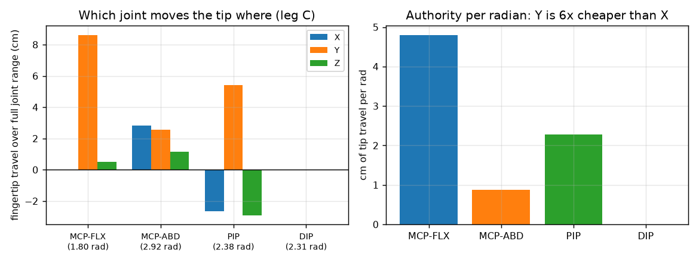

**EN**
- Per-radian tip displacement differs by an order of magnitude across joints: **FLX moves the tip ~10.6 cm/rad, ABD only ~2.3 cm/rad**.
- This is why the hand is a "flexion machine": sideways motion is expensive, so lateral stability is the weak axis.

**中文**
- 不同关节每弧度推动指尖的距离差一个量级：**FLX 约 10.6 cm/rad，ABD 只有约 2.3 cm/rad**。
- 所以这台手是“屈曲机器”：**横向动作代价极高**，横向稳定性就是最弱的那条轴。

---

### 1.4 ⭐ 为什么这很难 / Why This Is Hard

> **一台 16 自由度的手，靠四个 5 球指尖支撑——是在走钢丝，不是一个步态问题。**

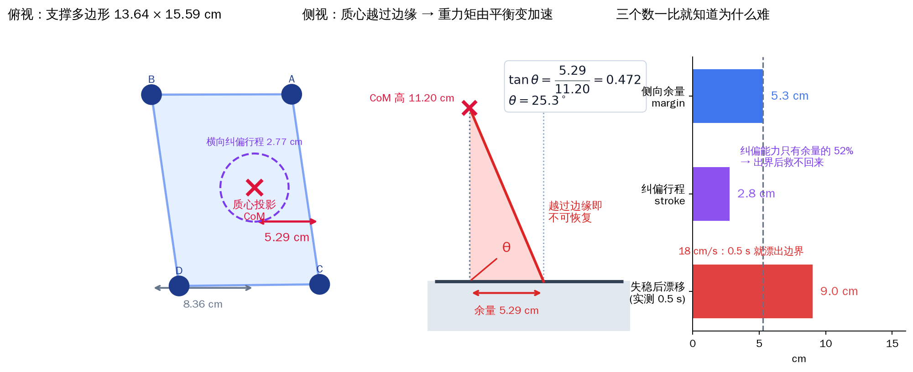

| 量 / Quantity | 实测值 / Value | 后果 / Consequence |
|---|---|---|
| 总质量 / Total mass | **1.139 kg** | 轻但刚度大 |
| 质心高度 / CoM height | **11.20 cm** | 翻倒力臂长 |
| 支撑多边形 / Support polygon | **13.64 × 15.59 cm** | 面积小 |
| 质心横向偏移 / CoM offset | **0.78 cm**（左 8.35 / 右 5.29） | **余量左右不对称** |
| **最小侧向余量 / Min lateral margin** | **5.29 cm** | 18 cm/s 漂移下只有 **0.29 s** |
| **静态翻倒角 / Static tipping angle** | **侧向 25.3° / 前后 34.2°** | 小扰动即翻 |
| 横向纠偏行程 / Lateral stroke | **2.77 cm** | 来不及纠偏 |
| 雅可比各向异性 / Jacobian anisotropy | **κ ≈ 13 : 1** | 横向几乎推不动 |

**讲稿（这 30 秒最关键）**
> “很多人会问：不就是让手走两步吗？我这里给四个数字。它只有 5.3 厘米的侧向余量，质心还偏了 0.8 厘米；静态翻倒角只有 25 度；横向纠偏的行程总共 2.77 厘米。也就是说——**它往侧面漂 5 厘米就会倒，而它能用来救自己的行程只有 2.8 厘米。** 这不是一个算法问题，是一个物理余量问题。”

---

### 1.5 初始位姿：High vs Low / Initial State

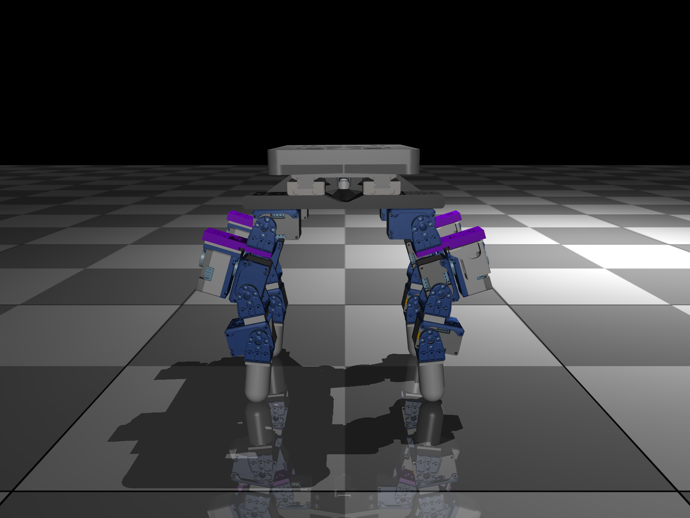

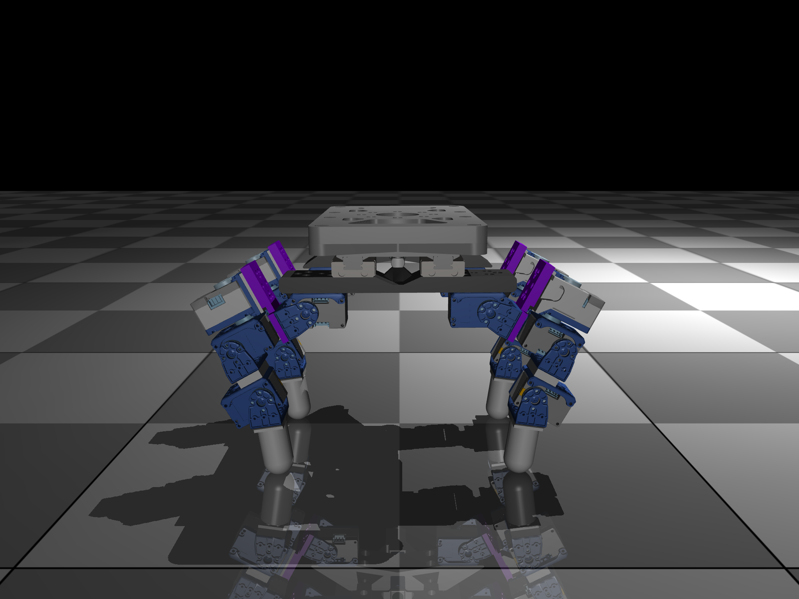

**EN**
- Two spawn poses: **high stance** (shallow flex) vs **low stance** (deep flex + ±0.63 rad ABD splay).
- Splay widens the support polygon **11.6 cm → 13.7 cm** and lowers the CoM, which raises the tipping angle.
- Every episode starts with a **200-step settle** (PD to q₀) to remove penetration and residual velocity — otherwise the first off-by-0.7 termination bug makes every episode end instantly.

**中文**
- 两种初始位姿：**高位站姿**（浅屈曲）vs **低位站姿**（深屈曲 + ±0.63 rad 外展）。
- 外展把支撑域从 **11.6 → 13.7 cm**，同时降低质心、抬高翻倒角。
- 每个 episode 先做 **200 步沉降**（PD 到 q₀），消除穿透和残余速度——否则会因为“竖直轴取错列”的 bug 让每一步都立刻判摔。

> 图注改进：在 High / Low 两张图上**直接标出支撑域宽度和翻倒角**。现在那个红箭头没告诉听众任何信息。

---

### ❓Slide 1 可能被问什么

| 问题 | 怎么答 |
|---|---|
| “你的脚是点接触还是面接触？” | 5 球垫（1.6 cm），是**小面接触**，会滚会翘。这也是不能省 DIP 的原因——DIP 转向决定垫子朝向。 |
| “为什么用四元数不用欧拉角？” | 基座带 −90° 旋转，欧拉角在该位形会万向节死锁。 |
| “16 个电机放指尖位置，3 维空间不是冗余吗？” | 单指 4 DoF 对 3 维指尖位置确实冗余 1 个（那就是 DIP，用来调垫子朝向和抬脚）。真正受限的是**横向**，不是位置维度。 |
| “支撑域 13.6 × 15.6 也不算特别小吧？” | 面积不小，但**质心偏了 0.78 cm**，右侧只剩 5.29 cm；而且质心高 11.2 cm，翻倒角只有 25°。是**余量**小，不是**面积**小。 |

<!--slide-->

## Slide 2 — 步态与推导 / Gait & Derivation

**这一页要干的事**：只讲**一条公式**（接触锚定），然后给出最终步态参数。
不要在台上推 DH 全表——那是 backup。

### 2.1 前进从哪来：一条公式 / Where Forward Motion Comes From

**EN**
- In stance, a fingertip cannot slip:

$$J_c(q)\,\dot q = 0 \;\Longrightarrow\; \boxed{\,v_{\text{body}} = -J_c^{-1}J_j\,\dot q_j\,}$$

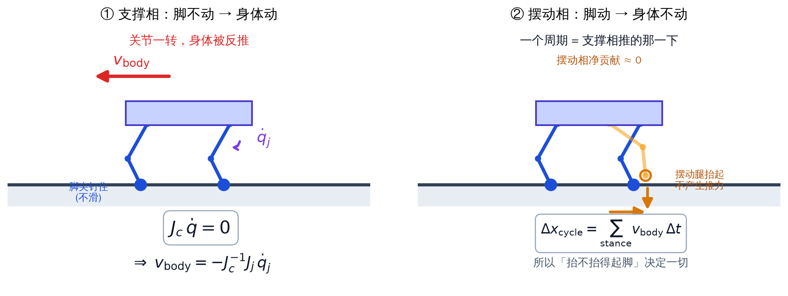

- **The entire locomotion problem is this one line**: move the joints, the body gets pushed backwards. Contact is the "closure constraint" here — it plays the role the closed-loop linkage plays on a wheel-legged robot.

**中文**
- 支撑相指尖不能滑：

$$J_c(q)\,\dot q = 0 \;\Longrightarrow\; v_{\text{body}} = -J_c^{-1}J_j\,\dot q_j$$

- **整个 locomotion 就这一行**：关节一转，机体被反推着走。这里的“闭环约束”不是连杆闭环，而是**地面接触约束**。

**推导三步（如果被要求展开）**
1. 指尖速度是广义速度的线性函数：$\dot p_c = J_c(q)\dot q$。
2. 着地点不滑 ⇒ $\dot p_c = 0$ ⇒ $J_c\dot q = 0$。
3. 把 $\dot q$ 拆成机体 6 维和关节 16 维，整理解出 $v_{\text{body}}$。

---

### 2.2 最终步态：对角两点 / The Final Gait

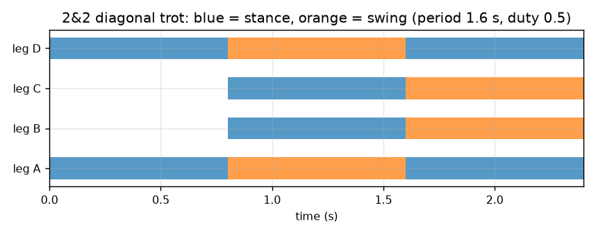

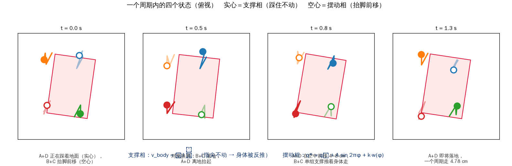

| 参数 / Parameter | 值 / Value | 说明 / Note |
|---|---|---|
| 步态 / Gait | **2&2 对角步态**（A+C / B+D） | 两组对角交替 |
| 周期 / Period | **1.6 s** | 慢而稳 |
| 支撑占空比 / Duty | **0.5** | 一半时间着地 |
| 髋摆幅 / Hip stride | **0.6 rad** | |
| 摆动屈膝 / Swing knee | **0.2 rad** | 抬脚量 |
| **前进速度 / Forward speed** | **3.11 cm/s** | 手工调 + 偏航反馈 |
| 偏航增益 / Yaw gain | **0.5** | 相比 0 提速 85% |
| 横向占比 / Sideways ratio | **11%** | 越小越直 |

**为什么选对角两点（而不是爬行）**
- 爬行（一次抬一条腿，占空比 0.75）**永远有 3 条腿着地，最稳**，但实测**后退 20.9 cm/3.6 s**——因为指尖只有 ~2 cm 抬升能力，摆动腿离不了地，左右对称扫摆互相抵消。
- 对角两点只靠 2 条腿支撑，但**抬脚时间短、节律快**，能靠惯性和接触切换把身体推出去。稳定性靠“**快切换**”而不是“**多着地**”。

**讲稿**
> “我们先试的教科书答案——爬行。结果它往后走。原因很具体：这台手的指尖只能抬 2 厘米，摆动腿根本离不了地，前扫后扫相互抵消。所以我们换了对角两点：支撑时间短，但切换快，靠切换把身体推出去。”

---

### ❓Slide 2 可能被问什么

| 问题 | 怎么答 |
|---|---|
| “3.11 cm/s 是不是太慢了？” | 是慢，但**横向占比 6–11%**，40 秒不摔。速度是余量的函数：再快就回到 5.29 cm 余量的临界点。 |
| “为什么占空比是 0.5 不是 0.75？” | 0.75 是爬行的稳定解，但抬脚能力不足导致无净推力（见上）。0.5 牺牲静态稳定换动态推进。 |
| “锚定公式里 $J_c$ 可逆吗？” | 假设四个着地点不共面且线性无关，$J_c$ 是 6×22 的行满秩块，取关节子块求逆。实际中用最小二乘，退化位形用阻尼逆。 |
| “条件数 2.5 说明什么？” | 单指速度椭圆的轴比 σ₁/σ₂ = 13.9/5.56 = 2.5；工作空间边缘能到 343（几乎推不动某个方向）。 |

<!--slide-->

## Slide 3 — 失败案例与改进 / What Failed and What We Fixed

**这一页要干的事**：这是**加分页**。主动摆失败，比藏起来显示更深。但必须**每条失败对应一个可量化根因 + 一个具体修法**，否则变成流水账。

### 3.1 汇总表 / Summary

| 尝试 / Attempt | 结果 / Result | 根因 / Root cause | 修法 / Fix |
|---|---|---|---|
| 开环爬行 / Open-loop crawl | **−20.9 cm**（后退） | 指尖抬升只 ~2 cm | 只当相位先验 |
| 残差 RL（60 万步 PPO） | **0.52 s 侧翻** | 余量 5.29 cm vs 行程 2.77 cm | 改确定性控制 |
| 常数 bias 补偿 | bias −0.40 → **0.8 s 摔** | 开环无反馈，失稳不可逆 | 加偏航/横向反馈 |
| 横向增益 −4 | **摔** | 过纠偏 | lat_gain −2, τ=4 s |
| 偏航增益 0.6 | **摔** | 太激进 | 偏航增益 **0.5** ✔ |

---

### 3.2 RL 为什么失败（最常被问）/ The RL Failure, Quantified

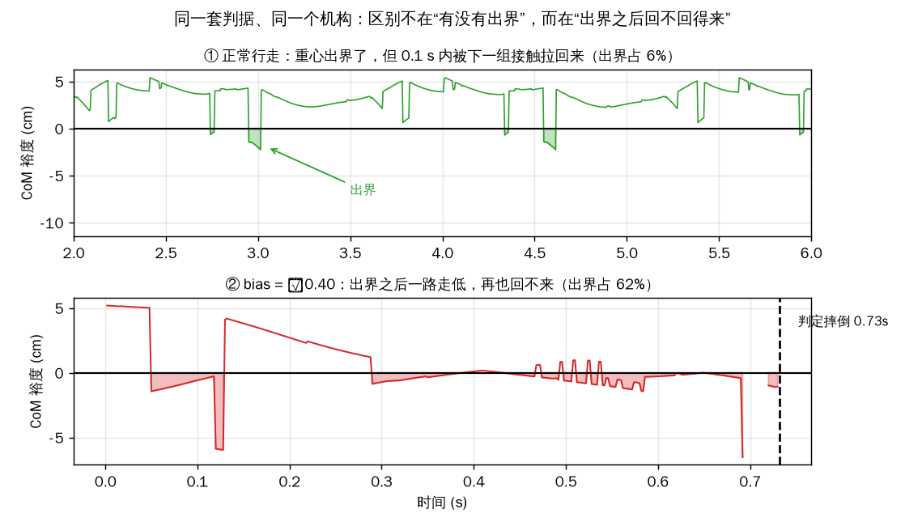

**EN** — `residual_last.zip`, 600k PPO steps, deterministic rollout:

```
t = 0.00 s   X = +0.6 cm    up = 1.00
t = 0.17 s   X = +3.1 cm    up = 0.97   ← tilting
t = 0.34 s   X = +6.1 cm    up = 0.89   ← past the support edge
t = 0.52 s   X = +10.1 cm   up = 0.70   ← terminated, roll 45.9°
```

- Drifts **18 cm/s sideways** vs **4.6 cm/s forward** — sideways is 4× forward.
- Reward **never exceeded** the do-nothing baseline (**+0.154 vs +0.197**); identical on every seed.

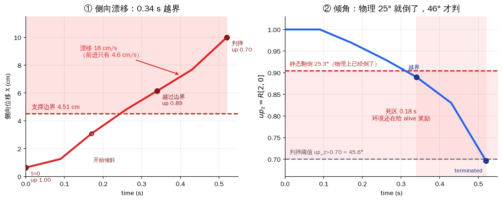

**中文**
- 残差策略 60 万步 PPO，确定性 rollout：**0.52 s 沿 +X 侧翻**，roll 45.9°。
- 横向漂移 **18 cm/s**，前进只有 **4.6 cm/s**——横向是前进的 4 倍。
- 奖励**从未超过**“什么都不做”基线（0.154 < 0.197），每个 seed 一模一样。

---

### 3.3 四层根因 / Four Root Causes

**EN**
1. **Physics** — 5.29 cm margin vs 2.77 cm stroke → **physically not recoverable**; not a policy problem.
2. **Interface** — one `RESIDUAL_SCALE = 0.25 rad` for all 16 joints; ABD is **13× more sensitive** than FLX, so random exploration on ABD is a sideways shove.
3. **Reward** — `W_TRACK + W_RES` make "do nothing" the optimum; `PEN_FALL = 20` ≈ only 0.4 s of standing; `V_SIGMA = 0.03` makes the speed Gaussian too sharp to give gradient.
4. **Bug** — timeout returned as `terminated` instead of `truncated` → value function systematically biased at time boundaries.

**中文**
1. **物理**——余量 5.29 cm、行程 2.77 cm，**物理上不可恢复**，不是策略菜。
2. **接口**——16 个关节共用一个 0.25 rad 残差尺度；ABD 敏感度是 FLX 的 13 倍，随机探索等于往侧面推。
3. **奖励**——“不动”就是最优解；摔倒惩罚只值 0.4 s 站立；速度高斯太窄，梯度几乎为零。
4. **实现 bug**——超时被当成 `terminated` 返回，价值函数在时间边界被系统性低估。

---

### 3.4 什么最后管用了 / What Finally Worked

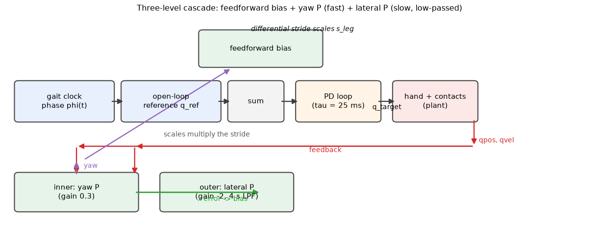

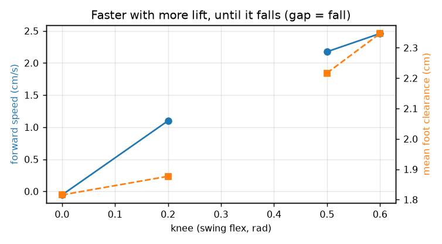

**EN**
- Abandon end-to-end RL → **deterministic open-loop trot + two scalar feedback gains**.
- **Yaw P** on stride differential (fast, inner): sideways 16.5% → 11%, **+85% speed**.
- **Lateral P** with **τ = 4 s** low-pass (slow, outer): sideways 9% → 6%. Acting on the raw error makes the two loops fight; low-passing fixes it.

**中文**
- 放弃端到端 RL → **确定性开环 trot + 两个标量反馈增益**。
- **偏航 P**（快，内环）作用在步幅差分：横向 16.5% → 11%，**提速 85%**。
- **横向 P**（慢，外环）+ **τ = 4 s** 低通：横向 9% → 6%。直接用原始误差两个环会打架，低通后就稳。

**讲稿**
> “三次 RL  Attempt，全部没超过‘什么都不做’。最后一次我们干脆承认：这台手能学的东西太少。于是回到确定性控制——开环步态保证节律，只加两个标量增益：一个管偏航，一个管横向。结果比 RL 好得多。”

---

### ❓Slide 3 可能被问什么

| 问题 | 怎么答 |
|---|---|
| “RL 真的努力过了吗？” | 60 万步 PPO、三次尝试（40 万/40 万/60 万）、奖励重调过。证据是**奖励从未超过零残差基线**，说明可行解空间本身被物理余量压死了。 |
| “为什么两个反馈环要分快慢？” | 偏航（步幅差分）响应快、耦合强；横向（位置）响应慢。同速率会互相激励导致振荡，所以横向外环低通到 τ=4 s。 |
| “加宽支撑不就行了？” | 对，这正是 future work 第一条：splay 能把 11.6 → 13.7 cm，但质心偏移仍在，余量还是不对称。 |
| “bias 是什么？” | 一个标量，作用在左右步幅差上，用来偏转航向（相当于“方向盘”）。开环时它是唯一的方向控制量。 |

<!--slide-->

## Slide 4 — 结果与展望 / Results & Future Work

**这一页要干的事**：给一个**记得住的 headline**，诚实说一个**已知缺陷**，然后让 future work **直接接住第 3 页的阻塞**。

### 4.1 结果 / Results

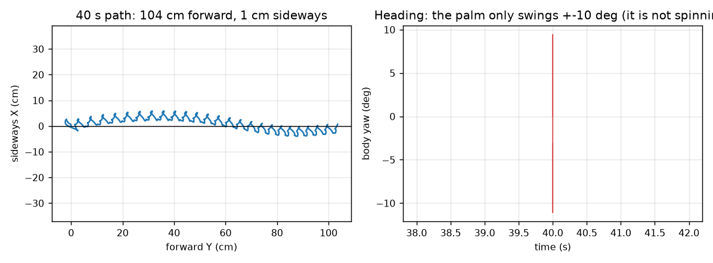

| 指标 / Metric | 值 / Value |
|---|---|
| 连续行走 / Continuous walk | **40 s，1.10 m，零摔倒** |
| 前进速度 / Forward speed | **3.11 cm/s** |
| 横向占比 / Sideways ratio | **6–11%** |
| 40 s 偏航漂移 / Yaw drift | **±7°** 以内 |
| 峰值关节力矩 / Peak torque | **10.0 N·m（打满限幅）** |
| RMS 关节力矩 / RMS torque | **1.19 N·m** |
| 单指条件数 κ(J) | **2.5**（home），工作空间 2–343 |

**Headline（放最大字号）**
> **40 秒 · 1.10 米 · 零摔倒。**

---

### 4.2 已知缺陷（要自己先说）/ Known Limitation

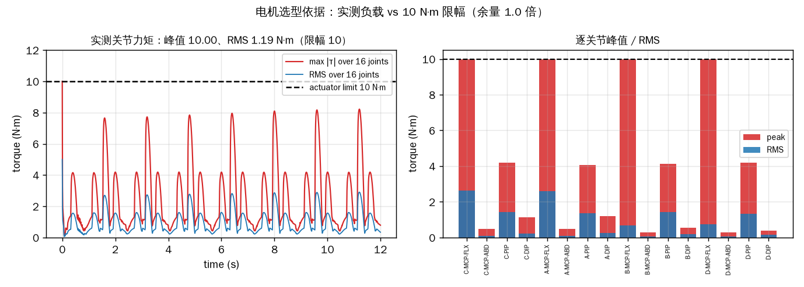

**EN**
- The four **MCP-FLX** joints saturate at the 10 N·m limit during stance — the actuator is under-sized for the dynamic load.
- Static gravity load is only **0.05 N·m**, so saturation comes from **impact + high PID gain**, not weight.

**中文**
- 4 个 **MCP-FLX** 在支撑相打满 10 N·m 限幅，电机动态余量不足。
- 静态重力只有 **0.05 N·m**，所以打满来自**冲击 + 高 PID 增益**，不是自重。

**讲稿**
> “我必须诚实说一个问题：四个 MCP-FLX 在支撑相是力矩打满的。静态重力只有 0.05 牛米，所以不是它撑不住，而是抬腿那一瞬间的冲击太大。这直接指向下一步。”

---

### 4.3 未来工作（每条都接第 3 页的阻塞）/ Future Work

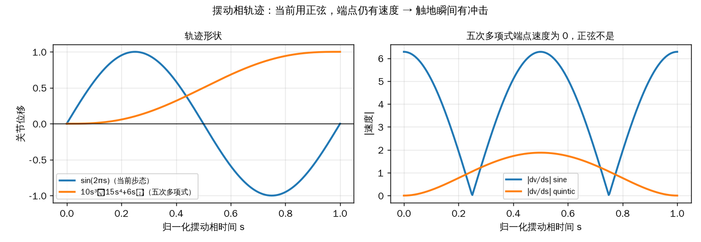

| # | 改什么 | 为什么（对应哪条失败/缺陷） |
|---|---|---|
| 1 | **加宽支撑**：侧向余量 5.29 → 7+ cm，翻倒角 25° → 35° | 接 3.3 层 1，物理余量翻倍 → 策略窗口 0.29 s → 0.5 s |
| 2 | **关节分别缩放**：ABD ≤ 0.08 rad，FLX 0.25 rad | 接 3.3 层 2，横向最敏感不该和屈曲同权 |
| 3 | **修正终止逻辑**：正确的 `truncated` + 价值 bootstrap | 接 3.3 层 4，修价值函数边界偏差 |
| 4 | **五次多项式摆动**：端点速度 6.28 → 0，峰值加速度 39.5 → 5.8 | 接 4.2，消除打满 FLX 的冲击 |
| 5 | **加大 FLX 电机 / 降 PID 增益** | 接 4.2，直接解决力矩饱和 |

**讲稿**
> “每一条 future work 都不是‘提升鲁棒性’这种空话，而是直接对着前面某个具体失败。比如最后一条五次多项式——正弦在摆动结束还有 6.28 的速度，等于带着速度砸下去，冲击就是 FLX 打满的元凶；换成五次多项式，端点速度降成零，峰值加速度降 7 倍。”

---

### 4.4 收尾 / Closing

**EN**
> A dexterous hand is not a small quadruped. Its stability margin is measured in **centimetres and single-digit degrees** — and that, not the learning algorithm, is what sets the ceiling.

**中文**
> 灵巧手不是小四足。它的稳定性余量以**厘米和个位数角度**计——决定上限的是这个物理事实，不是学习算法。

<!--slide-->

## 附 A — 讲稿时间分配（10 分钟版）

| Slide | 内容 | 时间 | 最该讲的一句 |
|---|---|---|---|
| 1 | 平台 + 难度量化条 | **3:00** | “5.29 cm 余量，25° 翻倒角” |
| 2 | 步态 + 一条公式 | **2:00** | “$J_c\dot q = 0 \Rightarrow v = -J_c^{-1}J_j\dot q_j$” |
| 3 | 三次失败 | **2:30** | “RL 0.52 秒侧翻，三个 seed 一模一样” |
| 4 | 结果 + future | **2:30** | “40 秒 1.1 米不摔；FLX 打满是指向未来” |

---

## 附 B — 必须准备的 Backup Slides

这五张正好是评审追问时最需要的：

1. **D-H 全表 + 前向运动学全展开** — `fig_dh_side.png` 右下角
2. **条件数工作空间热图**（κ 2 → 343） — `figs/fig_t2_workspace.png`
3. **速度椭圆 SVD**（σ = 13.9 / 5.6 / 1.8） — `figs/fig_t1_ellipse.png`
4. **力矩逐关节柱状图** — `figs/fig_t3_torque.png`
5. **sine vs quintic 对比** — `figs/fig_t4_trajectory.png`

---

## 附 C — 数字速查表（被问就报这张）

| 量 | 值 | 出处 |
|---|---|---|
| 自由度 | 16 驱动 + 6 浮动基座（nq 23, nv 22） | 模型 |
| 总质量 | 1.139 kg | 模型 |
| 质心高 | 11.20 cm | 结算后 |
| 支撑多边形 | 13.64 × 15.59 cm | 结算后 |
| 质心横向偏移 | 0.78 cm（左 8.35 / 右 5.29） | 结算后 |
| 静态翻倒角 | 侧 25.3° / 前后 34.2° | 结算后 |
| 横向行程 | 2.77 cm | 扫描 |
| 指尖抬升 | ~2 cm | 运动学 |
| 雅可比各向异性 | κ ≈ 13:1（FLX vs ABD） | 雅可比 |
| 单指条件数 | 2.5（home），2–343（工作空间） | SVD |
| 最终速度 | 3.11 cm/s，横向 6–11% | 40 s 记录 |
| 连续行走 | 40 s / 1.10 m / 0 摔 | 记录 |
| 峰值力矩 | 10.0 N·m（打满），RMS 1.19 N·m | 力矩记录 |
| 连杆 | FLX→PIP 59.9 / PIP→DIP 36.1 / DIP→tip 22.9 mm | 关节轴距 |
| 摆动轨迹端点速度 | 正弦 6.28 vs 五次多项式 0 | 轨迹分析 |
