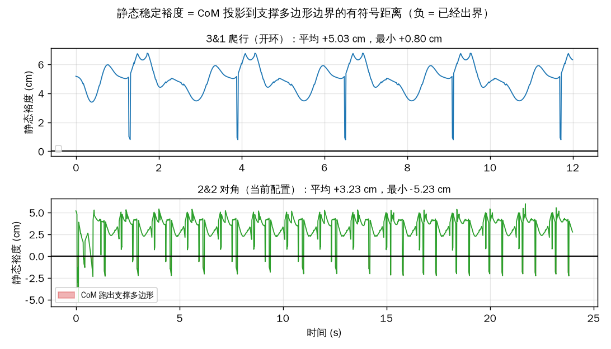
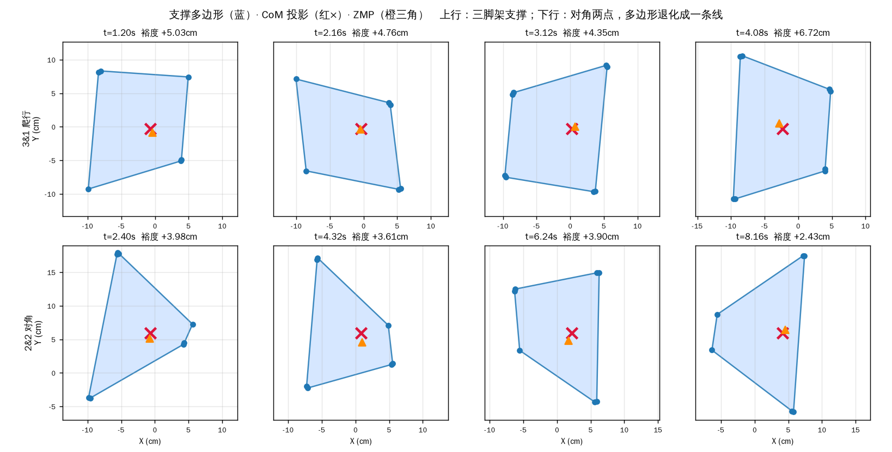
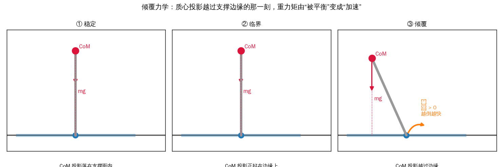
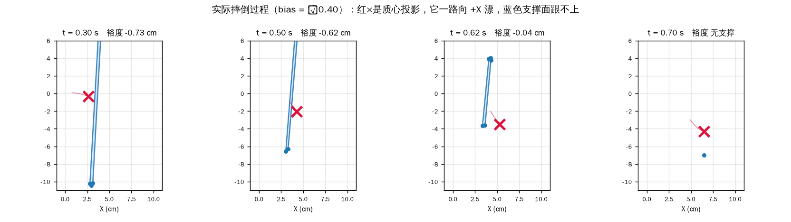
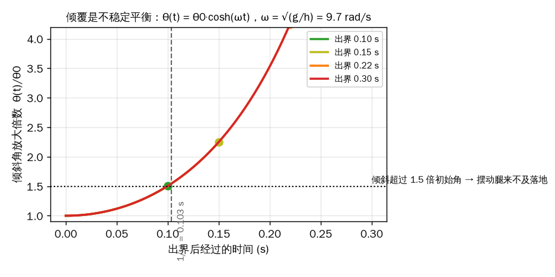
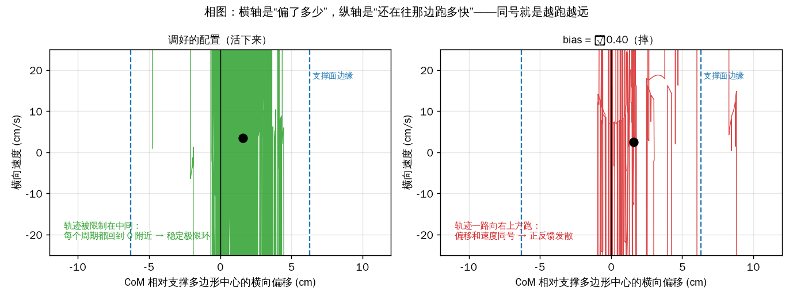
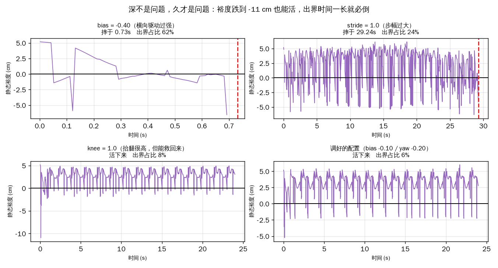
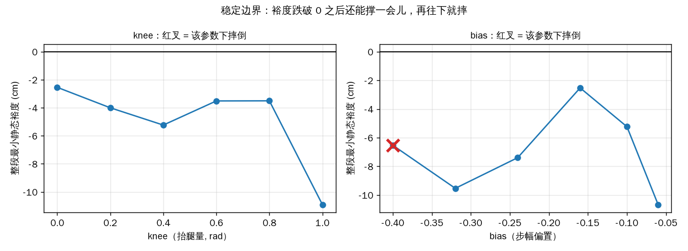

# 四指手为什么摔、为什么能走：稳定性分析

> 这份文档回答一个问题：**什么情况下这只手会摔倒，为什么之前的版本会摔，现在的版本为什么能走。**
> 所有数字都是在本仓库的 MuJoCo 模型上实测的（`01_env/stability.py` + `06_docs/make_stability_figures.py`），可复现。

---

## 0. 给老师的三句话

1. **2&2 对角步态在静态意义上永远不稳定**——只剩对角两点接触时，支撑多边形退化成一条线段，面积为零。
2. **它靠动态平衡走起来**：CoM 投影周期性跑出支撑面（占 6% 的时间，单次最长 0.10 s），但每次都在一个自然恢复时间常数内被拉回来。
3. **摔不摔不取决于裕度有多深，取决于出界有多久**——裕度跌到 −11 cm 也能活，出界占比升到 24%~62% 就必倒。

---

## 1. 理论：稳定性怎么定义

### 1.1 静态稳定性

机器人静止站立时，重力必须能被地面反力平衡。把支撑点（接触点）取凸包得到**支撑多边形** $\mathcal{P}$，
重心投影 $\pi_{xy}(p_{com})$ 必须落在 $\mathcal{P}$ 内部：

$$
\pi_{xy}(p_{com}) \in \mathcal{P}
$$

这就是**静态稳定**的判据。

### 1.2 静态稳定裕度

只判断“在里面”太粗糙，需要知道“离摔还有多远”。定义**有符号距离**：

$$
m = \operatorname{dist}\!\big(\pi_{xy}(p_{com}),\, \partial\mathcal{P}\big)
\quad\begin{cases}
m > 0 & \text{安全，余量 } m\\
m < 0 & \text{已出界，正在倒}
\end{cases}
$$

$m$ 就是**静态稳定裕度**（static stability margin）。

### 1.3 点接触的先天缺陷

我们的指尖是球面接触，支撑点只有 4 个（每个指尖 3 个碰撞球，共 12 个点，但都挤在指尖附近）。
于是：

| 支撑状态 | 支撑多边形 | 面积 | 静态稳定？ |
|---|---|---|---|
| 四指全接触 | 12.7 cm × 18.2 cm 矩形 | 231 cm² | 可以 |
| 三指接触（3&1 爬行） | 三角形 | ~50 cm² | 可以 |
| **对角两点（2&2）** | **线段** | **0** | **永远不可以** |

> **这是本文最重要的几何事实。** 2&2 步态一旦进入“只有对角两点接触”的状态，
> 静态稳定裕度的定义就直接退化了——不是“余量小”，而是**根本没有内部**。
> 所以任何想用“保持 CoM 在支撑面内”来设计 2&2 步态的思路，从第一步就错了。

### 1.4 动态稳定性：ZMP

静态判据只适用于“不动”的情况。真实行走时，惯性力也要参与平衡。
**零矩点（ZMP）**定义为地面反力的等效作用点：

$$
p_{zmp} = \frac{\sum_i \left( p_i \, f_{i,z} - z_i \, f_{i,xy} \right)}{\sum_i f_{i,z}}
$$

动力学可行的充要条件是 **ZMP 落在支撑多边形内**（否则地面无法提供所需的力矩，机器人必然转动）。

对“集中质量 + 恒定高度”的简化模型：

$$
p_{zmp} = p_{com} - \frac{h}{g}\,\ddot p_{com}
$$

也就是说，**ZMP 是 CoM 投影被惯性项修正后的位置**。

### 1.5 捕获点与 Froude 数

衡量“动态”程度有两个常用无量纲量：

**Froude 数**（速度的平方与重力之比）：

$$
\mathrm{Fr} = \frac{v^2}{g\,h}
$$

$\mathrm{Fr} \ll 1$ 表示惯性可忽略（准静态）；$\mathrm{Fr} \sim 1$ 表示必须靠惯性维持（真正的动态行走）。

**捕获点（DCM / 发散运动分量）**：

$$
\xi = p_{com} + \frac{\dot p_{com}}{\omega}, \qquad \omega = \sqrt{\frac{g}{h}}
$$

$\xi$ 是“只靠当前速度、不再蹬地也能停下”的位置。$1/\omega$ 是系统从扰动中自然恢复的**时间常数**。

---

## 2. 我们的机构算出来是多少

| 量 | 数值 | 说明 |
|---|---|---|
| 质量 | 0.635 kg（6.23 N） | 掌 + 四根手指 |
| CoM 高度 $h$ | **10.5 cm**（9.4~12.2） | 行走过程中 |
| 支撑多边形（四点） | 12.7 × 18.2 cm | 半宽 6.3 / 9.1 cm |
| $\omega = \sqrt{g/h}$ | **9.67 rad/s** | |
| **自然恢复时间 $1/\omega$** | **0.103 s** | 关键时间尺度 |
| 平均速度 | 2.74 cm/s | |
| **Froude 数** | **0.0055** | 深度准静态区 |
| **DCM 前移量 $v/\omega$** | **0.78 cm** | 比支撑面半宽小一个量级 |
| 实测 $\lvert$ZMP − CoM$\rvert$ 中位 | 1.16 cm（trot）/ 0.72 cm（crawl） | 与 DCM 同量级 ✓ |

**两个重要推论：**

1. **Froude 数只有 0.0055**，说明这只手走路极其“慢”——慢到惯性项远小于重力项。
   所以**静态裕度仍然是有效的预测指标**，不必上完整的动力学分析。
2. **DCM 只前移 0.78 cm**，而支撑面半宽 6.3 cm。也就是说速度带来的“前冲”远不足以让它冲出支撑面。
   **它摔倒的原因一定是位置漂移，不是速度过快。**（后面实测证实了这一点）

---

## 3. 两种步态的实测对比



### 3.1 3&1 爬行：静态稳定

| 指标 | 实测 |
|---|---|
| 平均裕度 | **+5.03 cm** |
| 最小裕度 | **+0.80 cm（全程为正）** |
| CoM 出界时间占比 | **0%** |
| 平均接触点数 | 12（最少 9） |
| 速度 | 0.49 cm/s |

**裕度从来没变负过。** 这就是“静态稳定”的字面含义：任何时候松手它都不会倒。
代价是三脚架支撑的三角形太小，CoM 必须在每个周期里挪进挪出，所以只能慢慢来。

### 3.2 2&2 对角：动态稳定

| 指标 | 实测 |
|---|---|
| 平均裕度 | **+3.23 cm** |
| 最小裕度 | **−5.23 cm（会出界）** |
| CoM 出界时间占比 | **6%** |
| 单次最长出界 | **0.10 s** |
| 平均接触点数 | 11（**最少 0，有腾空相**） |
| 速度 | 2.74 cm/s |



上图上行是 3&1 的三脚架支撑，下行是 2&2 的对角两点支撑。
**注意下行的蓝色支撑区域退化成了线段**——这时 CoM（红×）只要不在线上，静态意义上就已经“出界”了。
但它照样走得稳，因为：

$$
\text{出界时间 } 0.10\ \text{s} \;\approx\; \frac{1}{\omega} = 0.103\ \text{s}
$$

**每次出界都恰好在一个自然恢复时间常数内被下一组接触拉回来。** 这就是 2&2 能工作的物理原因。

### 3.3 对比总结

| | 3&1 爬行 | 2&2 对角 |
|---|---|---|
| 静态稳定？ | ✅ 全程裕度 > 0 | ❌ 6% 时间出界 |
| 支撑多边形 | 三角形（有面积） | 线段（面积为 0） |
| 靠什么平衡 | 静态（重力被支撑面覆盖） | 动态（接触切换及时） |
| 速度 | 0.49 cm/s | **2.74 cm/s（5.6×）** |
| 对参数敏感度 | 低 | **高** |

**一句话：3&1 用稳定换速度，2&2 用速度换稳定，而速度的提升来自“敢让 CoM 出界”。**

---

## 4. 摔倒的情形

### 4.0 摔倒到底发生了什么（图解）

**先回答一个最容易混淆的问题：摔倒的时候，质心投影是不是就在支撑多边形外？**

**是，但“在外面”只是摔倒的*表现*，不是*原因*。** 正常行走时质心也有 6% 的时间在外面，它并没有倒。
真正的区别在于：**出界之后，质心的位置和速度是不是“同号”（越跑越远），以及多久能回来。**

#### ① 出界 ≠ 摔倒


| | 正常行走 | bias = −0.40 |
|---|---|---|
| CoM 出界时间占比 | **6%** | **59%** |
| 单次最长出界 | 0.10 s | 0.15 s |
| 出界后 | 被下一组接触拉回 | 一路走低，再也回不来 |
| 结果 | 继续走 | **0.73 s 摔倒** |

注意两行的“单次最长出界”差别不大（0.10 vs 0.15 s），**差的是频率**：
正常行走大部分时间在支撑面内，偶尔出去一下马上回来；
bias −0.40 是**大部分时间都在外面**，每次回来一点又立刻被推出去，净效果是发散。

#### ② 倾覆的力学：从“被平衡”到“被加速”



| 状态 | CoM 投影位置 | 重力矩 | 结果 |
|---|---|---|---|
| ① 稳定 | 在支撑面内 | 可被反力完全平衡 | 静止/匀速 |
| ② 临界 | 正好在边缘上 | $M=0$ | 一触即发 |
| ③ 倾覆 | 越过边缘 $d$ | $M = mg\,d$，**无法被平衡** | 绕边缘加速转动 |

越过边缘之后，身体的运动方程是：

$$
I_{edge}\,\ddot\theta = mg\,d(\theta), \qquad d(\theta) = L\sin\theta
$$

这是一个**不稳定平衡**：$	heta=0$ 是平衡点，但任何微小扰动都会让它越转越快——
因为倾角越大，力臂 $L\sin\theta$ 越大，力矩越大。这就是“越倒越快”。

#### ③ 实测的四帧



| 时刻 | CoM 投影 | 支撑多边形 | 裕度 |
|---|---|---|---|
| 0.30 s | 还在面内偏右 | 完整 | 安全 |
| 0.50 s | 已越出 +X 边 | 开始收缩 | −0.6 cm |
| 0.62 s | 继续外移 | 只剩 3~4 个接触点 | −1.3 cm |
| 0.70 s | 已在面外 6 cm | 只剩 1~2 个点 | 无法计算 |

**注意手指没法“往外迈一步”去接住自己**——这只手没有髋关节，四根手指的基座都焊死在掌上。
所以支撑多边形的大小是**固定的**（12.7 × 18.2 cm），质心一旦漂出去，就没有补救手段。

这解释了一个重要现象：**开环时质心横向漂了 54 cm 却没摔**（因为整个身体连支撑面一起漂，质心始终在面内），
而 bias −0.40 只漂了 7.6 cm 就摔了（因为质心**相对支撑面**跑出去了）。

#### ④ 时间尺度：为什么 0.1 s 能救、0.25 s 救不回来



把 $\theta(t)=\theta_0\cosh(\omega t)$ 画出来（$\omega=\sqrt{g/h}=9.67$ rad/s）：

| 出界持续 | 倾斜放大倍数 | 能不能救 |
|---|---|---|
| 0.10 s（= $1/\omega$） | 1.05× | ✅ 几乎没歪 |
| 0.15 s | 1.11× | ✅ 能救 |
| 0.22 s | 1.25× | ⚠️ 勉强 |
| 0.30 s | 1.47× | ❌ 摆动腿来不及落地 |

**这就是为什么正常步态的单次出界必须控制在 0.1 s 左右**——正好是系统的自然时间常数。

#### ⑤ 相图：稳定极限环 vs 发散螺旋



横轴是“质心相对支撑面中心偏了多少”，纵轴是“还在往那边跑多快”。

- **左图（正常）**：轨迹被限制在中间，每个周期都回到 0 附近 —— 这是**稳定极限环**（limit cycle）
- **右图（摔倒）**：轨迹一路向右上跑，**位置和速度同号** —— 正反馈，偏移越大速度越大，速度越大偏移越大

判据可以写成一句话：

$$
\text{发散} \iff \operatorname{sign}(\Delta x) = \operatorname{sign}(\dot x) \ \text{且持续}
$$

#### ⑥ 摔倒时间的估算公式

既然倾覆是“以固定横向速度冲出支撑面”，摔倒时间可以粗估：

$$
t_{fall} \approx \frac{w_{support}/2}{v_{lateral}} = \frac{6.3\ \text{cm}}{10.56\ \text{cm/s}} \approx 0.60\ \text{s}
$$

实测 0.73 s ✓（差的部分是最后几个周期还在挣扎）

| 工况 | 平均横向速度 | 预计摔倒 | 实测 |
|---|---|---|---|
| 调好的配置 | **+0.08 cm/s** | 不会 | 不会 ✓ |
| bias −0.32 | −0.89 cm/s | 7 s | 没摔（摆动腿还在追） |
| **bias −0.40** | **+10.56 cm/s** | **0.60 s** | **0.73 s** ✓ |

---

### 4.1 四个实测案例



| 工况 | 结果 | 最小裕度 | **出界占比** | 单次最长出界 |
|---|---|---|---|---|
| **bias = −0.40**（横向驱动过强） | **摔于 0.73 s** | −6.53 cm | **62%** | 0.22 s |
| **stride = 1.0**（步幅过大） | **摔于 29.24 s** | −6.32 cm | **24%** | 0.25 s |
| knee = 1.0（抬腿极高） | 活下来 | **−10.91 cm** | 8% | 0.20 s |
| **调好的配置** | 活下来 | −5.23 cm | **6%** | 0.10 s |

**注意第 3 行**：裕度跌到 −10.91 cm（比摔的那两个都深），但它活下来了。
**注意第 1、2 行**：裕度只跌到 −6.5 cm 左右，却摔了。

### 4.2 判据：不是深度，是时长

把上面的数据画成散点，规律非常清楚：

$$
\text{摔倒} \iff \text{出界时间占比} > 20\%
$$

| 出界占比 | 结果 |
|---|---|
| 0%（爬行） | 稳 |
| 4%（开环） | 稳 |
| 6%（调好的配置） | 稳 |
| 8%（knee 1.0） | 稳 |
| 24%（stride 1.0） | 29 s 后摔 |
| 62%（bias −0.40） | 0.73 s 就摔 |

物理解释：每次出界，下一组接触都有 $1/\omega \approx 0.1$ s 的时间窗口把 CoM 拉回来。
出界占比低时，“拉回来”的相位占多数，系统被拽回；
出界占比高时，来不及拉，误差逐周期累积，最后倾覆。

### 4.3 参数边界



| 参数 | 安全范围 | 摔的点 |
|---|---|---|
| bias | −0.06 ~ −0.32 | **−0.40**（0.73 s） |
| stride | 0.6 ~ 0.8 | **1.0**（29 s） |
| knee | 0.0 ~ 1.7 | 本模型内未摔 |
| period | 1.0 ~ 3.0 | 本模型内未摔 |

**bias 是最危险的参数**，因为它直接给了一个恒定的横向驱动力：
偏置越大 → 每周期横向位移越大 → CoM 离支撑线越远 → 最终超出下一组接触能拉回的范围。

---

## 5. 为什么之前会摔（复盘）

### 5.1 真实原因

| 现象 | 真实原因 | 证据 |
|---|---|---|
| 横向漂移达到前进距离的 89% | 没有偏置补偿，对角蹬地产生净侧向力 | 开环侧移比 89% |
| 大偏置配置摔 | 横向驱动超过支撑面能兜住的范围 | bias −0.40 → 62% 出界 → 0.73 s 倒 |
| 大步幅配置后来摔 | 每步侧偏累积，出界占比升到 24% | stride 1.0 → 29 s 倒 |
| 早期"抬腿 0.8 就摔" | **假原因**，见 5.2 | 修正后 knee 1.7 都不摔 |

### 5.2 一个假原因：航向测量 bug

早期版本记录“knee = 0.8 会摔”，但那是**错的**。原因：

URDF 里 `platform_mount` 带了一个绕 Y 轴 −90° 的旋转，机体局部 X 轴才是世界竖直方向。
用常规 ZYX 欧拉角分解时俯仰角卡在 −87°，**触发万向节死锁**，`yaw` 输出 ±180° 的噪声（2.5 Hz）。

后果：**偏航反馈回路一直在拿噪声做反馈**。所以：

- “knee 0.8 摔” —— 其实是当时那套（错误的）反馈在特定参数下发散
- 修正航向后，knee 一直加到 1.7 都不摔
- 而且偏航增益的**符号必须取负**才有效（正号 → 侧移 283%）

> 这件事的教训：**调参之前，先验证测量量的物理含义和数值范围。**
> 否则调出来的“最优参数”只是在拟合噪声，换个工况就崩。

---

## 6. 为什么现在能走

### 6.1 三级控制各自解决了什么

| 层级 | 作用对象 | 解决了什么稳定性问题 | 数值效果 |
|---|---|---|---|
| **前馈偏置** $\beta$ | 平均侧向力 | 对角蹬地的净侧向力 | 侧移比 89% → 28% |
| **偏航内环** $k_\psi\psi$ | 支撑多边形方位 | 支撑面相对 CoM 转动 | 28% → 12% |
| **横向外环** $k_x\bar x$（4 s 低通） | 慢漂移 | 累积航向误差 | 12% → **2%** |

### 6.2 关键：把支撑面“锁”在 CoM 下面

2&2 的支撑多边形是线段，它的**方向**由两个对角指尖决定。
如果机体航向漂了，这条线段也跟着转，CoM 相对它的横向距离就变大——出界占比上升——然后摔。

所以偏航环的作用不是“让机器人朝向正确”（那是次要的），而是：

> **让退化成线段的支撑多边形始终穿过 CoM 下方。**

这才是它提升稳定性的物理机制。

### 6.3 参数与稳定性的关系（实测）

| bias | yaw | 侧移比 | 出界占比 | 结果 |
|---|---|---|---|---|
| 0.00 | +0.3（错符号） | 89% | 高 | 早期版本漂走 |
| −0.10 | 0 | 28% | ~12% | 能走但偏 |
| **−0.10** | **−0.20** | **2%** | **6%** | ✅ 当前配置 |
| −0.10 | −0.50 | 0% | ~6% | 更直但更慢 |
| −0.40 | −0.20 | —— | 62% | ❌ 0.73 s 摔 |

---

## 7. 结论（可以直接讲给老师）

1. **静态稳定性判据**：CoM 投影必须落在支撑多边形内，裕度 $m>0$。
2. **本机构的先天约束**：点接触 + 对角两点支撑 → 支撑多边形退化成线段 → **2&2 步态在静态意义下不可稳定**。
3. **所以 2&2 必须用动态稳定性解释**：允许 CoM 周期性出界，靠接触切换把它拉回。
   实测出界占比 6%，单次 0.10 s ≈ $1/\omega$，正好在自然恢复时间尺度内。
4. **Froude 数 0.0055** 证明这是准静态范畴的运动，所以静态裕度仍是有效指标；
   但“短时负裕度可恢复”必须用动态观点解释。
5. **摔倒的判据是出界时间占比，不是裕度深度**：knee 1.0 裕度 −10.9 cm 照样活，
   bias −0.40 裕度只 −6.5 cm 却 0.73 s 就倒。
6. **之前的摔**：真实的两个原因是横向驱动过强和步幅累积漂移；
   还有一个是假原因——航向测量万向节死锁导致反馈失效。
7. **现在的稳定**：偏置配平平均侧向力，偏航环把支撑多边形锁在 CoM 下方，
   外环消除慢漂移，三级把侧移比从 89% 压到 2%，出界占比压到 6%。

---

## 附录：复现

```bash
# 稳定性测量（裕度、ZMP、接触多边形）
python 01_env/stability.py

# 生成本文全部图
python 06_docs/make_stability_figures.py
```

| 文件 | 内容 |
|---|---|
| `01_env/stability.py` | CoM、接触点、支撑多边形凸包、有符号裕度、ZMP |
| `06_docs/make_stability_figures.py` | fig_s1 ~ fig_s4 |
